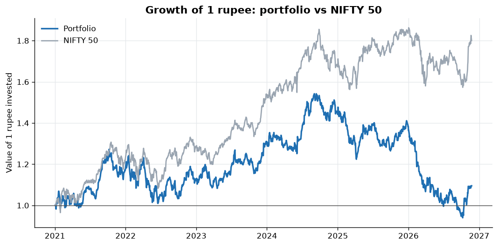
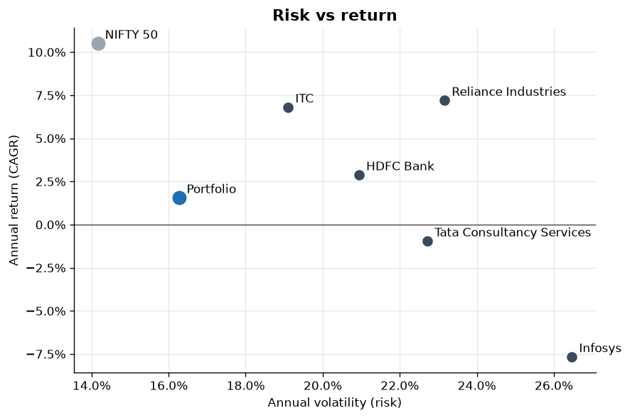
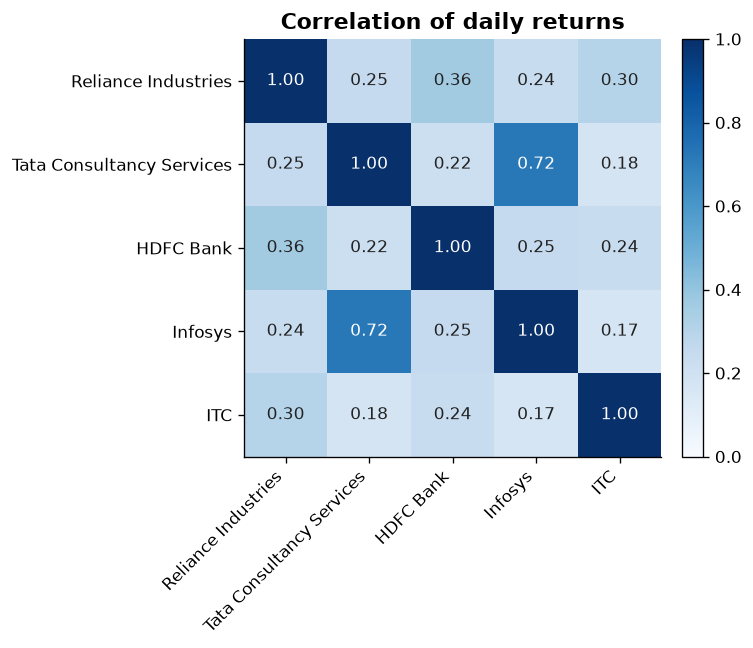

# 9th Street Market

[](https://github.com/zulqhar9/9th-street-market/actions/workflows/tests.yml)

**Live Indian and world market dashboard and investing tools**

🔗 **Live demo: [9thstreetmarket.streamlit.app](https://9thstreetmarket.streamlit.app)**

A Python + SQL project: a live market website for Indian equities, with world indices and US stocks alongside, plus a portfolio risk analyser that also runs as a command-line report.

## The website

| Page | What it does |
|---|---|
| **Market Dashboard** | Live NIFTY 50: a widget board (index, gold ₹ per 10 g, silver ₹ per kg, market breadth, top mover), a sortable list of all 50 stocks with intraday sparklines, and market news. Shows when the market is open, closed or on an exchange holiday. |
| **World Markets** | Eight global indices (S&P 500, Nasdaq, Dow, FTSE 100, DAX, Nikkei 225, Hang Seng, ASX 200) with open/closed/lunch/holiday status in each exchange's own time zone, the biggest US stocks priced in dollars or rupees, and every market's trading hours in IST (adjusting for daylight saving). |
| **Compare Stocks** | Up to four Indian or US stocks (or the NIFTY 50 / S&P 500) on one chart from the same starting point, e.g. TCS vs Infosys vs Accenture. US returns can include the rupee's move against the dollar. Side-by-side table of return, yearly return, volatility, worst fall, 52-week range, P/E and market value. |
| **Sectors** | NIFTY 50 sectors ranked by their move today, this week, month, quarter or year, weighted by company value, with each sector's best and worst stock. |
| **Stock Lookup** | Search all ~2,600 NSE-listed companies and ~5,900 US-listed stocks. Each stock gets an interactive chart (1D, 1W, 1M, 6M, 1Y, 5Y; line or candlesticks), price, market value, P/E ratio, 52-week position and its own news; US stocks also show the rupee cost of one share. Shareable links like `/stock?symbol=TCS` or `/stock?us=AAPL`. |
| **What If I Invested?** | Pick an amount, a start date and up to four investments (any NSE stock, the NIFTY 50, gold or silver) and see what they'd be worth today, with growth, annual return and worst fall. |
| **Portfolio Analyser** | Edit a holdings table and see return vs the NIFTY 50, volatility, drawdown, Sharpe ratio, beta, allocation and correlation. |
| **Stock Screener** | Filter the NIFTY 50 by sector, P/E ratio and 52-week position, or use quick screens like "near 52-week low" or "up today". |
| **SIP Calculator** | What a monthly investment grows to, with an optional yearly step-up, shown as invested vs growth over time. |
| **Capital Gains Tax** | Short- or long-term capital gains tax on a share sale under current Indian rules (20% / 12.5%, ₹1.25 lakh exemption, 4% cess, pre-2018 grandfathering), plus how much waiting for long-term treatment would save. |
| **Learn** | Plain-English guides to P/E, CAGR, drawdown, the Sharpe ratio, beta and compounding, each with a try-it example. |
| **About** | Who built the site, the skills it uses, and how it works. |

| What | Refreshes | Note |
|---|---|---|
| NIFTY 50 stocks and index | every 60 s | Yahoo Finance, about 15 min delayed |
| Gold, silver, US$/₹ | every 60 s (cached 5 min) | International COMEX prices; Indian retail prices add duty and GST |
| Company values (sector weights, news) | every 6 h | |
| News | every 30 min | Headlines only, linked to the source |

Stock lists come from NSE's public archives and Nasdaq Trader's public symbol directory, and are refreshed with `python scripts/update_stock_lists.py`.



## What it answers

- **Did my portfolio beat the market?** Time-weighted annual return (CAGR) vs the NIFTY 50.
- **How bumpy was the ride?** Annualised volatility and the worst fall from a peak (max drawdown).
- **Was the return worth the risk?** Sharpe ratio, and beta to the market.
- **Am I really diversified?** Correlation between holdings and allocation by value.

## Example portfolio results

The sample portfolio in `portfolio.csv` puts about ₹10,000 into each of the **10 largest NSE companies by market value (as of Nov 2026)**, all bought on 4 Jan 2021. Prices to Nov 2026:

| | Annual return | Volatility | Max drawdown | Sharpe |
|---|---|---|---|---|
| Portfolio | +15.3% | 15.3% | -16.5% | 0.61 |
| NIFTY 50 | +10.5% | 14.2% | -17.2% | 0.34 |

What the analysis shows:

- **₹1.01 lakh grew to ₹2.34 lakh (+131%)**, beating the index by about 5% a year with similar risk and a slightly smaller worst fall.
- **Returns were very uneven.** SBI (+346%) and Bharti Airtel (+334%) did most of the work, while TCS and Hindustan Unilever lost money over almost six years.
- **Banks move together.** HDFC, ICICI, SBI and Kotak have daily-return correlations around 0.4–0.55, so four "different" stocks behave partly like one bet. TCS and Hindustan Unilever, with correlations near 0.2, did the most for diversification.
- **Caution: survivorship bias.** These are *today's* top 10, picked with hindsight. SBI and Bharti Airtel are in the list partly *because* they rose so much, so the result flatters the strategy. A fair test would use the top 10 as they stood in January 2021.

| Risk vs return | Correlation |
|---|---|
|  |  |

The full output is in [`reports/summary.md`](reports/summary.md).

## How it works

```
portfolio.csv ──► SQLite (holdings)          sql/positions.sql ──► cost, value, gain per stock
Yahoo Finance ──► SQLite (prices) ──────────►sql/monthly_returns.sql
                                     └──────► Python metrics ──► charts + report
```

| Part | What it does |
|---|---|
| `app.py`, `webapp/` | The Streamlit website: dashboard page, portfolio page and Plotly charts |
| `analyser/live.py` | Live quotes, intraday prices, market values, stock facts, gold/silver in rupees, news, NSE market hours and holidays |
| `analyser/sip.py` | SIP maths: monthly instalments, yearly step-up, closed-form check |
| `analyser/whatif.py` | "What if I invested" maths in rupees for stocks, the NIFTY 50, gold and silver |
| `analyser/world.py` | World indices, top US stocks, exchange hours with lunch breaks, daylight saving and holiday detection |
| `analyser/tax.py` | Indian capital gains tax rules (short/long term, exemption, grandfathering, cess) |
| `data/nifty50.csv`, `data/nse_equities.csv` | Official NSE lists of NIFTY 50 constituents (with sectors) and all listed equities |
| `data/us_equities.csv` | US-listed common stocks and ADRs (ETFs, warrants, units and preferred shares filtered out) |
| `analyser/analysis.py` | One analysis pipeline shared by the website and the command-line report |
| `analyser/fetch.py` | Downloads split- and dividend-adjusted daily closes with `yfinance` |
| `sql/schema.sql` | `prices` and `holdings` tables |
| `sql/positions.sql` | Buy price, latest price and gain per holding, using a correlated subquery and `ROW_NUMBER()` |
| `sql/monthly_returns.sql` | Month-end returns using `ROW_NUMBER()` and `LAG()` window functions |
| `analyser/metrics.py` | CAGR, volatility, drawdown, Sharpe, beta, and a time-weighted portfolio index |
| `analyser/charts.py` | Five charts (matplotlib) |
| `tests/test_metrics.py` | Unit tests for the calculations |

### Method notes

- **Time-weighted returns.** Buying a new stock adds money but isn't a gain. The portfolio index only uses holdings owned the day before, so stocks bought on different dates don't distort performance.
- **Risk-free rate.** The Sharpe ratio assumes 6.5% a year, roughly an Indian government bond yield. Change it with `--risk-free`.
- **Buy price** is the adjusted close on the first trading day on or after each buy date.

## Run it

Requires Python 3.10+.

```bash
python -m venv .venv
.venv\Scripts\activate          # Windows  (macOS/Linux: source .venv/bin/activate)
pip install -r requirements.txt

streamlit run app.py            # start the website at http://localhost:8501
python main.py                  # download prices and build the report
python main.py --offline        # rebuild from stored prices, no download
python -m unittest discover tests
```

To analyse your own portfolio, edit `portfolio.csv`:

```csv
ticker,name,shares,buy_date
RELIANCE.NS,Reliance Industries,10,2021-01-04
```

NSE tickers end in `.NS` (BSE: `.BO`). Output goes to `reports/`.

## Tech

Python · pandas · SQLite (window functions, CTEs) · Streamlit · Plotly · matplotlib · yfinance · unittest

---

*Built for analysis and learning. Not investment advice. The sample portfolio is illustrative.*
