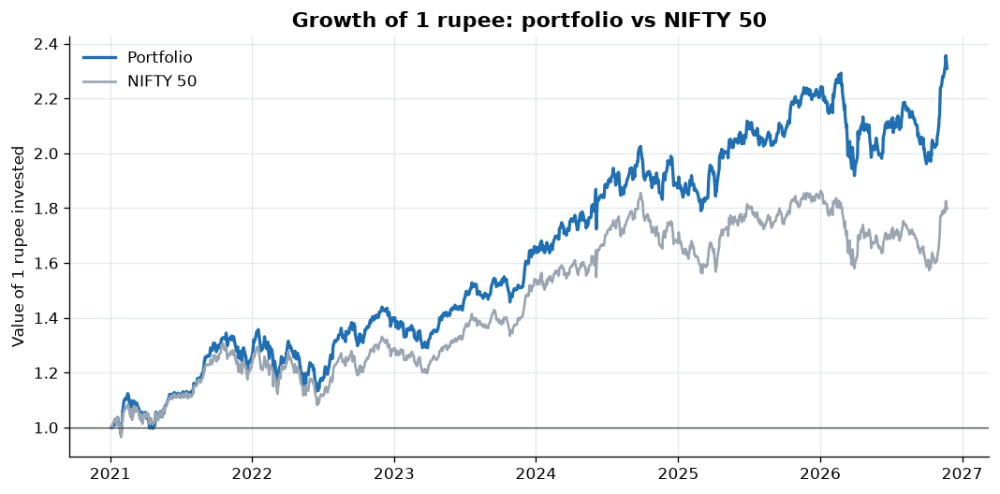
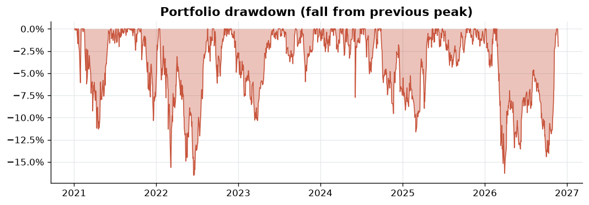
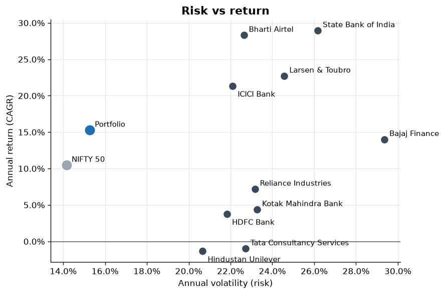
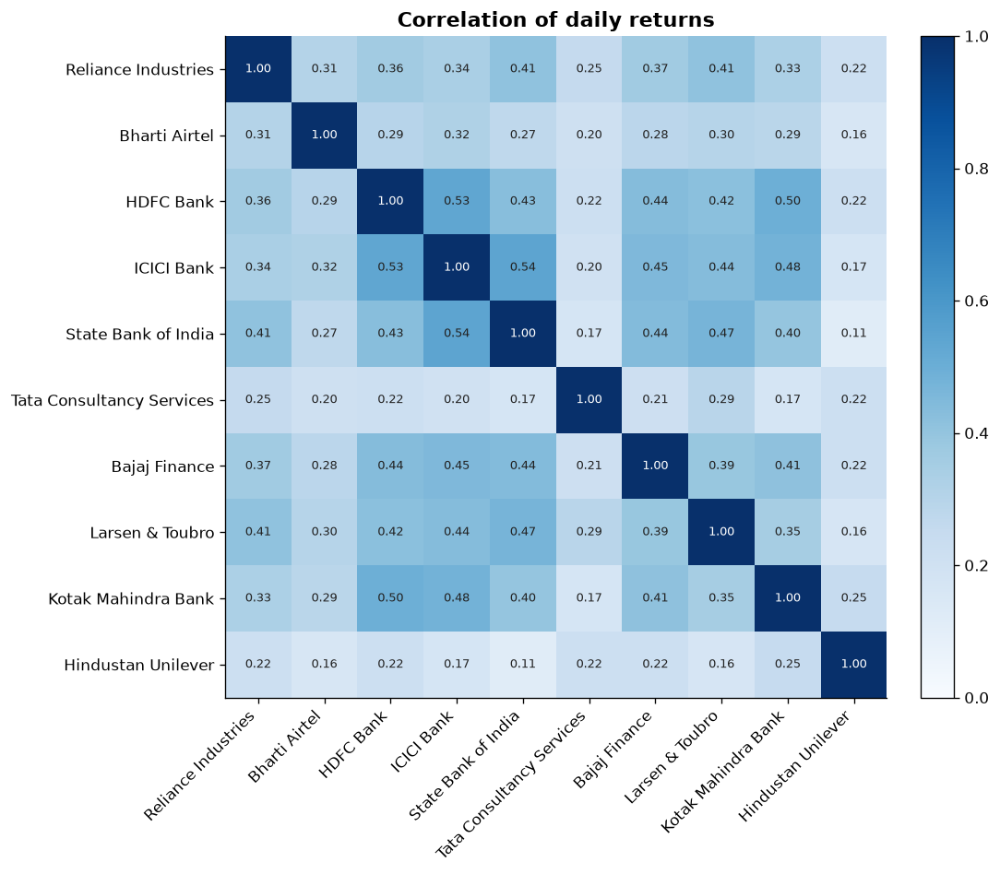

# Portfolio report

Generated 23 Nov 2026. Prices up to 2026-11-23.

## Summary

- Invested **₹101,265**, now worth **₹233,865** (+130.9%).
- Annual return (time-weighted): **+15.3%** vs NIFTY 50 **+10.5%** over the same period.
- Worst fall from a peak: **-16.5%** (portfolio) vs -17.2% (NIFTY 50).
- Sharpe ratio 0.61 (risk-free rate assumed 6.5% a year); beta 1.02 to the NIFTY 50.

## Holdings

| Stock | Shares | Bought | Cost | Value | Return |
|---|---|---|---|---|---|
| State Bank of India | 39 | 2021-01-04 | ₹9,935 | ₹44,351 | +346.4% |
| Bharti Airtel | 20 | 2021-01-04 | ₹9,798 | ₹42,492 | +333.7% |
| Larsen & Toubro | 8 | 2021-01-04 | ₹9,883 | ₹32,972 | +233.6% |
| ICICI Bank | 20 | 2021-01-04 | ₹10,199 | ₹31,868 | +212.5% |
| Bajaj Finance | 20 | 2021-01-04 | ₹10,157 | ₹21,971 | +116.3% |
| Reliance Industries | 11 | 2021-01-04 | ₹9,884 | ₹14,874 | +50.5% |
| Kotak Mahindra Bank | 26 | 2021-01-04 | ₹10,161 | ₹13,079 | +28.7% |
| HDFC Bank | 15 | 2021-01-04 | ₹9,895 | ₹12,311 | +24.4% |
| Hindustan Unilever | 5 | 2021-01-04 | ₹10,941 | ₹10,124 | -7.5% |
| Tata Consultancy Services | 4 | 2021-01-04 | ₹10,412 | ₹9,822 | -5.7% |

## Risk and return

Each stock is measured from its own buy date; the portfolio and benchmark from the first buy date.

|  | Total return | CAGR | Volatility | Max drawdown | Sharpe | Beta |
|---|---|---|---|---|---|---|
| Portfolio | +130.9% | +15.3% | 15.3% | -16.5% | 0.61 | 1.02 |
| NIFTY 50 | +79.7% | +10.5% | 14.2% | -17.2% | 0.34 | 1.00 |
| Reliance Industries | +50.5% | +7.2% | 23.2% | -27.2% | 0.15 | 1.09 |
| Bharti Airtel | +333.7% | +28.3% | 22.6% | -18.8% | 0.96 | 0.80 |
| HDFC Bank | +24.4% | +3.8% | 21.8% | -31.7% | -0.01 | 1.09 |
| ICICI Bank | +212.5% | +21.4% | 22.1% | -22.3% | 0.72 | 1.07 |
| State Bank of India | +346.4% | +29.0% | 26.2% | -23.9% | 0.88 | 1.20 |
| Tata Consultancy Services | -5.7% | -1.0% | 22.7% | -53.4% | -0.21 | 0.78 |
| Bajaj Finance | +116.3% | +14.0% | 29.4% | -33.4% | 0.39 | 1.31 |
| Larsen & Toubro | +233.6% | +22.7% | 24.6% | -28.9% | 0.72 | 1.17 |
| Kotak Mahindra Bank | +28.7% | +4.4% | 23.3% | -29.9% | 0.03 | 0.98 |
| Hindustan Unilever | -7.5% | -1.3% | 20.7% | -37.6% | -0.27 | 0.55 |

## Charts

_For analysis and learning only. Not investment advice._
