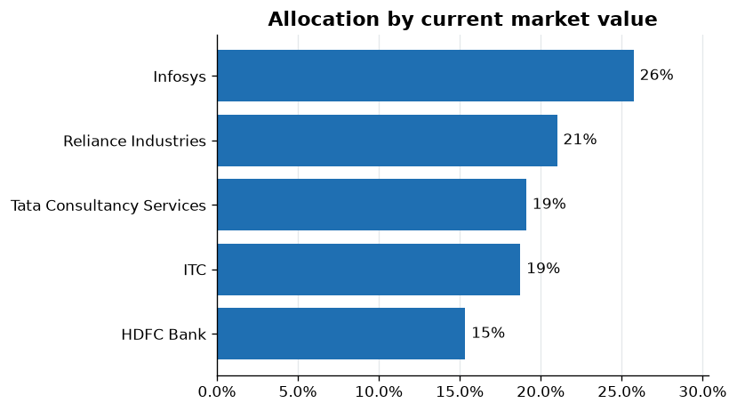

# Portfolio report

Generated 23 Nov 2026. Prices up to 2026-11-23.

## Summary

- Invested **₹63,895**, now worth **₹64,330** (+0.7%).
- Annual return (time-weighted): **+1.6%** vs NIFTY 50 **+10.5%** over the same period.
- Worst fall from a peak: **-39.0%** (portfolio) vs -17.2% (NIFTY 50).
- Sharpe ratio -0.21 (risk-free rate assumed 6.5% a year); beta 0.90 to the NIFTY 50.

## Holdings

| Stock | Shares | Bought | Cost | Value | Return |
|---|---|---|---|---|---|
| Infosys | 15 | 2022-01-03 | ₹24,462 | ₹16,569 | -32.3% |
| Reliance Industries | 10 | 2021-01-04 | ₹8,986 | ₹13,525 | +50.5% |
| Tata Consultancy Services | 5 | 2021-01-04 | ₹13,015 | ₹12,298 | -5.5% |
| ITC | 40 | 2022-06-01 | ₹8,982 | ₹12,064 | +34.3% |
| HDFC Bank | 12 | 2021-06-01 | ₹8,451 | ₹9,873 | +16.8% |

## Risk and return

Each stock is measured from its own buy date; the portfolio and benchmark from the first buy date.

|  | Total return | CAGR | Volatility | Max drawdown | Sharpe | Beta |
|---|---|---|---|---|---|---|
| Portfolio | +9.5% | +1.6% | 16.3% | -39.0% | -0.21 | 0.90 |
| NIFTY 50 | +80.0% | +10.5% | 14.2% | -17.2% | 0.35 | 1.00 |
| Reliance Industries | +50.5% | +7.2% | 23.2% | -27.2% | 0.15 | 1.09 |
| Tata Consultancy Services | -5.5% | -1.0% | 22.7% | -53.4% | -0.21 | 0.78 |
| HDFC Bank | +16.8% | +2.9% | 20.9% | -31.7% | -0.06 | 1.07 |
| Infosys | -32.3% | -7.7% | 26.5% | -48.2% | -0.41 | 0.97 |
| ITC | +34.3% | +6.8% | 19.1% | -45.0% | 0.12 | 0.65 |

## Charts

_For analysis and learning only. Not investment advice._
